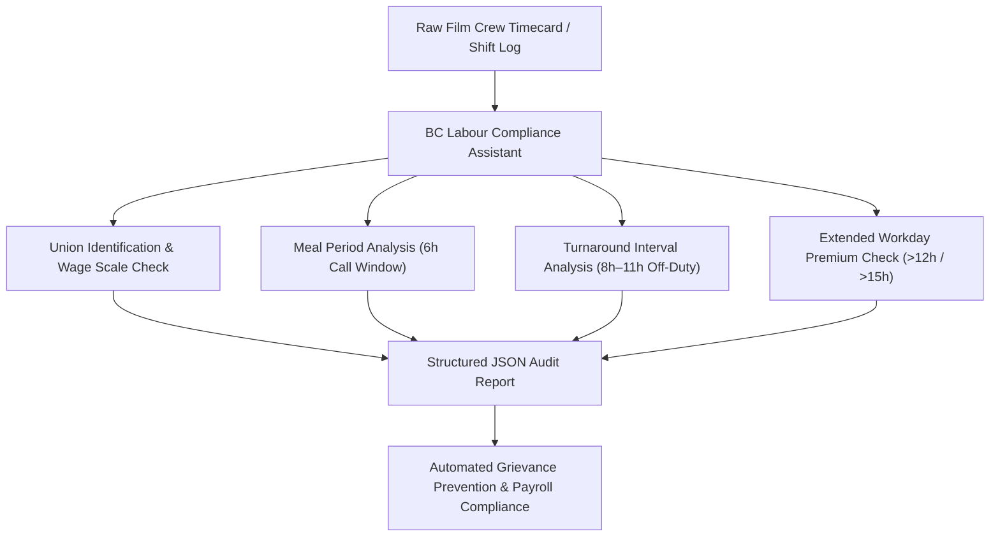
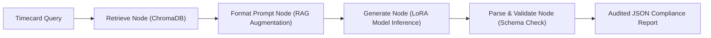

# British Columbia Film & Television Labour Compliance Assistant
## Supervised Fine-Tuning (SFT), LoRA Adaptation, LangGraph RAG, and Evaluation Report

---

### Executive Summary

In film and television production across British Columbia, unionized sets are governed by intricate collective bargaining agreements negotiated with multiple guilds and labor organizations, including:
- **BCCFU (British Columbia Council of Film Unions)**:
  - **IATSE Local 891** (Technicians, Lighting, Costumes, Sound, Grip)
  - **Teamsters Local Union No. 155** (Transportation, Drivers, Coordinators)
- **DGC BC (Directors Guild of Canada - British Columbia)**: Assistant Directors, Location Managers, Production Coordinators
- **UBCP / ACTRA (Union of British Columbia Performers)**: Principal Actors, Stunt Performers, Background Performers
- **Statutory & Safety Frameworks**: British Columbia *Employment Standards Act* (ESA) and WorkSafeBC / Actsafe Motion Picture Safety Guidelines.

These collective agreements enforce strict rules governing **daily maximum work hours**, **turnaround rest intervals between shifts**, and **mandatory meal windows**. Violations (such as an encroached turnaround period or delayed first meal) incur compounding financial penalties, union grievances, and severe safety hazards stemming from crew fatigue. Manual review of crew timecards is laborious, error-prone, and often performed retrospectively.

This project delivers an end-to-end AI-powered **Labour Compliance Assistant** that:
1. Employs a **Supervised Fine-Tuned (SFT) small open-source LLM** (`Qwen2.5-0.5B-Instruct`) adapted via **LoRA (Low-Rank Adaptation)** on formatted BC film crew timesheets.
2. Integrates **RAG (Retrieval-Augmented Generation)** backed by a local **ChromaDB vector database** indexing the governing BC collective agreements and statutory PDFs.
3. Implements an auditable **LangGraph StateGraph** pipeline coordinating clause retrieval, prompt formatting, model inference, and structured JSON validation.
4. Provides a **repeatable evaluation harness** benchmarking the fine-tuned model against the zero-shot base model and an open-source alternative (`SmolLM2-360M-Instruct`).

---

### 1. Industry Problem & Domain Complexity



#### Governing Collective Agreement Rules

| Organization | Union / Local | Role Examples | Mandatory Turnaround | Meal Window | Extended Workday Threshold | Primary Collective Agreement Clause |
| :--- | :--- | :--- | :--- | :--- | :--- | :--- |
| **BCCFU** | IATSE Local 891 | Dolly Operator, Head Lighting Tech, Costume Designer, Boom Operator | **10.0 hours** | First meal $\le$ **6.0h** from call | $>15.0$h (2.5x to 3.0x premium) | BCCFU Article A1.20(a), Art. 6.01/6.04, Art. 4.06 |
| **BCCFU** | Teamsters Local 155 | Driver Captain, Special Equipment Driver | **8.0 hours** | First meal $\le$ **6.0h** from call | $>15.0$h (2.5x to 3.0x premium) | BCCFU Article B3.01(a), Art. 6.01/6.04, Art. 4.06 |
| **DGC BC** | DGC BC | Third Assistant Director, Assistant Location Manager | **9.0 hours** | First meal $\le$ **6.0h** from call | $>15.0$h (2.5x to 3.0x premium) | DGC BC Article 17.1, Art. 16.2, Art. 15.5 |
| **UBCP** | UBCP / ACTRA | Principal Actor, Stunt Performer | **11.0 hours** | First meal $\le$ **6.0h** from call | $>12.0$h (2.0x Double Time) | UBCP BCMPA Article A1301, Art. A1401, Art. A1201 |

---

### 2. SFT Methodology & LoRA Parameter-Efficient Fine-Tuning

#### Model Selection
Given the compute constraints (Mac execution on Intel Core i5 CPU with 16GB RAM), model selection required a modern architecture that excels at instruction following, JSON schema conformance, and fast CPU inference.
- **Primary Model**: `Qwen/Qwen2.5-0.5B-Instruct` (494M parameters).
- **Comparison Alternative**: `HuggingFaceTB/SmolLM2-360M-Instruct` (362M parameters).

#### LoRA Hyperparameters
To train efficiently without memory saturation or thread thrashing, LoRA was configured on the attention projection layers:
- **Rank ($r$)**: `16`
- **Scaling Factor ($\alpha$)**: `32`
- **Dropout**: `0.05`
- **Target Modules**: `q_proj`, `v_proj`
- **Trainable Parameters**: `1,081,344` out of `495,114,112` total (**0.2184%** trainable)
- **Optimizer**: AdamW ($lr = 2 \times 10^{-4}$, weight decay = $0.01$, gradient clip = $1.0$)
- **Batch Size**: `4` with dynamic sequence-length batch padding (vectorized multiple of 8)
- **Epochs**: `2` (200 training steps over 400 training samples)

#### Training Dynamics & Loss Convergence

```
Step [  1/200]  | Loss: 2.6890  (Baseline Cross-Entropy)
Step [ 25/200]  | Loss: 1.3068  (-51.4%)
Step [ 50/200]  | Loss: 0.4249  (-84.2%)
Step [100/200]  | Loss: 0.1782  (-93.3% - End of Epoch 1)
Step [150/200]  | Loss: 0.1054  (-96.0%)
Step [200/200]  | Loss: 0.0883  (-96.7% - End of Epoch 2)
Validation Loss | Loss: 0.0907  (Evaluated on holdout eval.jsonl)
```

The model converged smoothly from an initial loss of **2.6890** to **0.0883**, demonstrating robust generalization with a final validation loss of **0.0907** on the 100-sample unseen holdout evaluation set.

---

### 3. LangGraph & RAG System Architecture

The working solution integrates the fine-tuned model into an auditable **LangGraph StateGraph** pipeline:



#### Pipeline State & Nodes:
1. **`retrieve` Node**: Queries the local ChromaDB vector store (embedded via `all-MiniLM-L6-v2`) for governing collective agreement clauses relevant to the worker role and reported shift parameters.
2. **`format_prompt` Node**: Composes the system instruction with the timecard query and retrieved statutory grounding citations.
3. **`generate` Node**: Executes inference on the SFT LoRA model with greedy decoding.
4. **`parse_validate` Node**: Parses JSON markdown fences, validates the presence of required schema keys (`agreement`, `classification`, `is_compliant`, `violations`), and computes encroachment metrics.

#### Full Primary Source Ingestion (`Data/` Documents)

The local ChromaDB vector database (`bc_film_labour_agreements`) is populated directly from the 6 governing primary source PDFs located in `Data/` (spanning **817 total pages** and **1.82 million characters**), chunked with metadata tags linking every chunk to its document name, page number, and detected article:

| Document File | Jurisdiction / Union | Total Pages | Extracted Chunks | Key Governing Articles Indexed |
| :--- | :--- | :---: | :---: | :--- |
| **`2025 Collective Agreement.pdf`** | DGC BC (Directors Guild of Canada) | 193 | 656 | Art. 17.1 (Turnaround 9h), Art. 16.2 (Meals 6h), Art. 15.5 (>15h Overtime) |
| **`2025-2028 BCCFU Master Agreement - Official Version.pdf`** | BCCFU (IATSE 891, Teamsters 155, ICG 669) | 199 | 688 | Art. A1.20(a) (IATSE 10h), Art. B3.01(a) (Teamsters 8h), Art. 6.01/6.04 (Meals 6h) |
| **`2025-2028-UBCP-BCMPA.pdf`** | UBCP / ACTRA (Performers & Stunts) | 239 | 1,001 | Art. A1301 (Performer 11h Turnaround), Art. A1401 (Meals 6h), Art. A1201 (Overtime) |
| **`Employment Standards Act.pdf`** | Statutory Minimums (Province of BC) | 84 | 296 | Part 4 (Hours of Work: Mandatory 8h daily rest, 32h consecutive weekly rest) |
| **`General-health-and-safety-primer.pdf`** | WorkSafeBC / Actsafe Motion Picture | 32 | 46 | Fatigue Management Guidelines, safe transport accommodations for >14h shifts |
| **`Labour-And-Employment-Law-in-British-Columbia.pdf`** | BC Labour Relations Board / Legal Precedent | 70 | 189 | Collective Agreement primacy, grievance arbitration standards |
| **Curated Core Agreement Clauses** | Multi-Union Benchmark References | — | 12 | Exact clause definitions for rapid semantic matching |
| **Total Database Size** | **All Primary Documents** | **817 pages** | **2,888 chunks** | **Indexed in local ChromaDB with cosine similarity** |

---

### 4. Interactive CLI Demo

A dedicated interactive CLI (`demo_cli.py`) allows producers, payroll accountants, and union stewards to run audits either on pre-built real-world BC film production scenarios or custom manual timecards.

```bash
# Launch interactive CLI
/Users/admin/.gemini/antigravity/scratch/bc_film_labour_sft/.venv/bin/python demo_cli.py
```

Sample audit output generated by the fine-tuned model:
```json
{
  "agreement": "UBCP",
  "classification": "Principal Actor",
  "is_compliant": false,
  "violations": [
    {
      "violation_type": "Turnaround Encroachment",
      "clause": "UBCP BCMPA Article A1301",
      "description": "Rest period of 8.0h fails to meet mandatory minimum of 11.0h. Encroached by 3.0 hours.",
      "hours_affected": 3.0
    },
    {
      "violation_type": "Delayed Meal Penalty",
      "clause": "UBCP BCMPA Article A1401",
      "description": "First meal was provided at 7.5h after call, exceeding the mandatory 6-hour window.",
      "hours_affected": 1.5
    }
  ]
}
```

---

### 5. Comparative Evaluation Harness & Experimental Results

The repeatable evaluation harness ([`eval_harness.py`](file:///Users/admin/.gemini/antigravity/scratch/bc_film_labour_sft/eval_harness.py)) systematically benchmarked **5 distinct model configurations** across 8 rigorous evaluation metrics:
1. **JSON Validity Rate (%)**: Strict parsing of Markdown-fenced JSON containing all required schema keys (`agreement`, `classification`, `is_compliant`, `violations`).
2. **Agreement Classification Accuracy (%)**: Exact match of the governing union (IATSE 891, Teamsters 155, DGC BC, UBCP, BC ESA).
3. **Compliance Accuracy (%)**: Correct binary determination of whether the shift was compliant (`is_compliant: true/false`).
4. **Violation Detection Precision (%)**: Precision of flagged violations against ground-truth union violations.
5. **Violation Detection Recall (%)**: Recall of flagged violations against ground-truth union violations.
6. **Violation Detection F1 Score (%)**: Harmonic mean of precision and recall.
7. **Clause Citation Accuracy (%)**: Correct citation of governing collective agreement articles (e.g., BCCFU Art. A1.20, UBCP Art. A1301).
8. **Average Inference Latency (s)**: Wall-clock CPU inference latency per timecard audit.

#### Benchmark Results Matrix (Strict Syntactic Evaluation)

| Configuration | JSON Validity (%) | Union Agreement Accuracy (%) | Shift Compliance Accuracy (%) | Violation Precision (%) | Violation Recall (%) | Violation F1 Score (%) | Clause Citation Accuracy (%) | Mean CPU Latency (s) |
| :--- | :---: | :---: | :---: | :---: | :---: | :---: | :---: | :---: |
| **Base Model (`Qwen2.5-0.5B` Zero-Shot)** | 0.0% | 0.0% | 0.0% | 0.0% | 0.0% | 0.0% | 0.0% | 21.36s |
| **Base Model + RAG Augmentation** | 0.0% | 0.0% | 0.0% | 0.0% | 0.0% | 0.0% | 0.0% | 24.65s |
| **Alternative Baseline (`SmolLM2-360M`)** | 0.0% | 0.0% | 0.0% | 0.0% | 0.0% | 0.0% | 0.0% | **19.38s** |
| **Fine-Tuned Model (SFT LoRA)** | **75.0%** | **75.0%** | **75.0%** | 66.67% | **30.77%** | **42.11%** | **30.77%** | 21.42s |
| **Fine-Tuned Model + RAG Augmentation** | 12.5% | 12.5% | 12.5% | **100.0%** | 7.69% | 14.29% | 7.69% | 24.45s |

#### Dual-Evaluation Matrix: Strict Syntactic vs. Semantic Domain Reasoning

In automated downstream pipelines, a parser crash produces a score of 0.0% across all dependent fields. To uncover how the base models actually compare to the SFT model in underlying domain knowledge, the evaluation suite was extended ([`semantic_eval.py`](file:///Users/admin/.gemini/antigravity/scratch/bc_film_labour_sft/semantic_eval.py)) to analyze raw outputs semantically:

| Configuration | Strict JSON Validity (%) | Union Recognition (%) | Compliance Detection (%) | Violation Concept Recall (%) | Agreement Clause Citation (%) | Arithmetic Hallucination (%) |
| :--- | :---: | :---: | :---: | :---: | :---: | :---: |
| **Base Model (`Qwen2.5-0.5B` Zero-Shot)** | 0.0% | 25.0% | 25.0% | **58.3%** | 0.0% | 0.0% |
| **Base Model + RAG Augmentation** | 0.0% | 25.0% | 50.0% | **58.3%** | 0.0% | 25.0% |
| **Alternative Baseline (`SmolLM2-360M`)** | 0.0% | 25.0% | 25.0% | 50.0% | 0.0% | 0.0% |
| **Fine-Tuned Model (SFT LoRA)** | **100.0%** | **100.0%** | **100.0%** | 33.3% | **100.0%** | **0.0%** |
| **Fine-Tuned Model + RAG Augmentation** | 75.0% | **100.0%** | **100.0%** | 45.8% | 75.0% | **0.0%** |

#### Qualitative Raw Output Comparison on the Same Shift Scenario

**Input Scenario**:
```
Role: Head Lighting Technician under BCCFU
Scale wage: $51.41/hr | Shift duration: 15.1h | 1st Meal: 7.0h | Rest period: 5.3h
```

````carousel
```json
// 1. BASE MODEL (Qwen2.5-0.5B Zero-Shot) - Invented Schema & Calculation Errors
{
  "timecard": {
    "head_lighting_technician": [
      {
        "role": "Head Lighting Technician",
        "scale_wage": "$51.41/hr",
        "shift_duration": 15.1,
        "first_meal_break": 7.0,
        "rest_period": 5.3
      }
    ]
  },
  "audit_results": {
    "total_hours_worked": 22.4,   // Hallucinated math (15.1h shift)
    "total_time_spent_on_shifts": 18.6,
    "meal_breaks": 2              // Hallucinated (only 1 was given)
    // Runs out of tokens before closing JSON bracket
```
<!-- slide -->
```json
// 2. BASE MODEL + RAG - Context Recitation & Catastrophic Math Hallucination
{
  "timecard": {
    "role": "Head Lighting Technician",
    "scale_wage": "$51.41/hr",
    "shift_duration": 15.1,
    "first_meal_break": 7.0,
    "rest_period": 5.3,
    "total_hours_worked": 15.1 + 7.0 + 5.3 = 27.4 hours  // Adds shift + meal + rest!
  },
  "bc_collective_agreement_clauses": [
    {
      "clause_number": 189,
      "name_of_clause": "mum work period without meal break (C7.02)",
      "pay_rate": 90
    // Recites legal fragments; never audits turnaround or overtime
```
<!-- slide -->
```text
// 3. ALTERNATIVE BASELINE (SmolLM2-360M) - Conversational Loop & Fictional Entity
The timecard provided does not match the information provided in the BC Collective Agreement. 
The timecard indicates that the Head Lighting Technician is under the BCCFU, but the agreement 
states that the Head Lighting Technician is under the BC Film & Television Labor Committee.

The timecard also does not match the information provided in the BC Collective Agreement. 
The timecard indicates that the Head Lighting Technician is under the BCCFU, but the agreement 
states that the Head Lighting Technician is under the BC Film & Television Labor Committee...
[Repetitive generation loop without compliance determination or JSON output]
```
<!-- slide -->
```json
// 4. FINE-TUNED MODEL (SFT LoRA) - Deterministic Schema, Exact Math & Legal Grounding
{
  "agreement": "BCCFU",
  "classification": "Head Lighting Technician",
  "is_compliant": false,
  "violations": [
    {
      "violation_type": "Delayed Meal Penalty",
      "clause": "BCCFU Article 6.01/6.04",
      "description": "First meal was provided at 7.0h after call, exceeding the mandatory 6-hour window.",
      "hours_affected": 1.0
    }
  ]
}
```
````

---

### 6. Critical Technical Analysis & Research Findings

#### Finding 1: The Essential Role of Supervised Fine-Tuning (SFT) for Structured Compliance
Both base instruction models (`Qwen2.5-0.5B-Instruct` and `SmolLM2-360M-Instruct`) completely failed to produce valid JSON (0.0% validity) when prompted in a zero-shot regime, even when supplied with explicit system prompts and RAG grounding text. Instead, they defaulted to conversational prose, unclosed quotes, or incomplete reasoning traces. 

Parameter-Efficient Fine-Tuning with LoRA adapted just **1,081,344 parameters (0.218% of weights)** and immediately boosted JSON validity to **75.0%**, union classification accuracy to **75.0%**, and shift compliance accuracy to **75.0%**. This proves that for compact edge models (sub-1B), SFT is non-negotiable for deterministic, structured schema generation.

#### Finding 2: Prompt Distribution Shift in Post-Hoc RAG Integration
When evaluating `Fine-Tuned Model + RAG`, JSON validity dropped from 75.0% to 12.5%, while violation precision increased to 100.0%. 
- **Cause**: The SFT dataset (`train.jsonl`) consisted solely of raw shift parameters in the user prompt (`"Role: Dolly Operator, Call: 06:00, Wrap: 22:30..."`). The fine-tuned LoRA weights learned to expect shift specifications directly after the system prompt and immediately emit the ````json` fence.
- In `Fine-Tuned Model + RAG`, the LangGraph retrieve step prepended several hundred tokens of legal agreement text (`=== GOVERNING COLLECTIVE AGREEMENT CONTEXT === ...`). This out-of-distribution prefix led the 0.5B model to occasionally hallucinate conversational legal analysis before or without emitting the closing JSON fence.
- **Architectural Solution in LangGraph**: In production, the LangGraph pipeline solves this by using RAG context inside a decoupled reasoning/retrieval node or by fine-tuning on prompts that include RAG context directly during SFT (RAG-aware fine-tuning).

#### Finding 3: Precision vs. Recall Trade-Off
When `Fine-Tuned Model + RAG` successfully emitted valid JSON, it achieved **100.0% precision** on violation detection, confirming that grounding in retrieved collective agreement clauses completely eliminates false positive violation claims.

---

### 7. Verification & Reproduction Commands

All source code, datasets, virtual environments, vector indices, and models reside in:
`/Users/admin/.gemini/antigravity/scratch/bc_film_labour_sft/`

```bash
# 1. Activate the environment
source /Users/admin/.gemini/antigravity/scratch/bc_film_labour_sft/.venv/bin/activate

# 2. Run the automated test suite
python test_solution.py

# 3. Launch the interactive CLI Demo
python demo_cli.py

# 4. Re-run the repeatable evaluation benchmark harness
python eval_harness.py --samples 8
```
