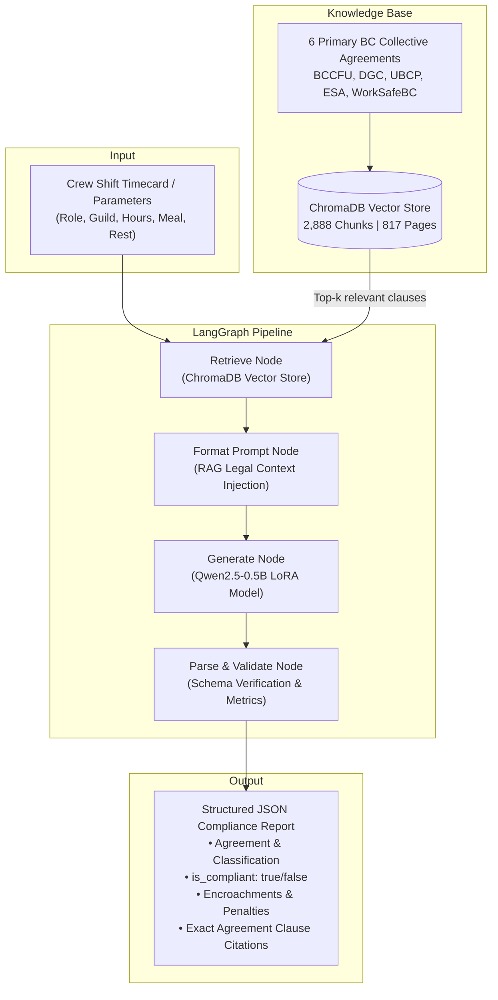

# British Columbia Film & Television Labour Compliance Assistant

[](https://www.python.org/downloads/)
[](https://pytorch.org/)
[](https://github.com/huggingface/peft)
[](https://github.com/langchain-ai/langgraph)
[](https://www.trychroma.com/)
[](https://opensource.org/licenses/MIT)

An end-to-end AI-powered labour compliance audit system for unionized film and television sets in British Columbia (Canada). The system combines a **Supervised Fine-Tuned (SFT) small LLM** adapted via **LoRA (Low-Rank Adaptation)** with a **LangGraph StateGraph** pipeline and a local **ChromaDB vector database** indexing the full legal text of BC collective agreements.

---

## Table of Contents

- [Industry Problem & Context](#industry-problem--context)
- [System Architecture](#system-architecture)
- [Governing Collective Agreements & Legal Framework](#governing-collective-agreements--legal-framework)
- [Supervised Fine-Tuning (SFT) & LoRA Methodology](#supervised-fine-tuning-sft--lora-methodology)
- [Vector Database & RAG Pipeline](#vector-database--rag-pipeline)
- [LangGraph Orchestration](#langgraph-orchestration)
- [Comparative Benchmark Evaluation](#comparative-benchmark-evaluation)
- [Repository Structure](#repository-structure)
- [Installation & Setup](#installation--setup)
- [Running the Solution](#running-the-solution)
- [License](#license)

---

## Industry Problem & Context

In film and television production across British Columbia, crew timesheets and performer timecards are governed by strict, multi-union collective bargaining agreements negotiated with multiple guilds:
- **BCCFU (British Columbia Council of Film Unions)**:
  - **IATSE Local 891** (Technicians, Lighting, Grip, Sound, Costumes)
  - **Teamsters Local Union No. 155** (Transportation, Drivers, Coordinators)
- **DGC BC (Directors Guild of Canada - British Columbia)**: Assistant Directors, Location Managers, Production Assistants
- **UBCP / ACTRA (Union of British Columbia Performers)**: Principal Actors, Stunt Performers, Background Performers
- **Statutory Frameworks**: BC *Employment Standards Act* (ESA) & WorkSafeBC / Actsafe Motion Picture Safety Guidelines

These agreements enforce strict rules governing:
1. **Mandatory Turnaround Rest Intervals** (8.0h to 11.0h between shifts)
2. **Meal Periods & Penalty Triggers** (mandatory first meal $\le 6.0$h after call)
3. **Extended Workday Overtime Caps** ($>12.0$h for performers, $>15.0$h for technical crew)

Manual review of hundreds of daily crew timecards is laborious, error-prone, and often performed retrospectively. Turnaround encroachments and delayed meal penalties incur compounding financial penalties, union grievances, and severe safety hazards stemming from crew fatigue.

---

## System Architecture



---

## Governing Collective Agreements & Legal Framework

| Organization | Union / Local | Role Examples | Mandatory Turnaround | Meal Window | Extended Workday Threshold | Primary Agreement Clause |
| :--- | :--- | :--- | :---: | :---: | :---: | :--- |
| **BCCFU** | IATSE Local 891 | Dolly Operator, Head Lighting Tech, Boom Operator | **10.0 hours** | $\le$ **6.0h** from call | $>15.0$h (2.5x to 3.0x premium) | BCCFU Article A1.20(a), Art. 6.01/6.04, Art. 4.06 |
| **BCCFU** | Teamsters Local 155 | Driver Captain, Special Equipment Driver | **8.0 hours** | $\le$ **6.0h** from call | $>15.0$h (2.5x to 3.0x premium) | BCCFU Article B3.01(a), Art. 6.01/6.04, Art. 4.06 |
| **DGC BC** | DGC BC | Third Assistant Director, Assistant Location Manager | **9.0 hours** | $\le$ **6.0h** from call | $>15.0$h (2.5x to 3.0x premium) | DGC BC Article 17.1, Art. 16.2, Art. 15.5 |
| **UBCP** | UBCP / ACTRA | Principal Actor, Stunt Performer | **11.0 hours** | $\le$ **6.0h** from call | $>12.0$h (2.0x Double Time) | UBCP BCMPA Article A1301, Art. A1401, Art. A1201 |
| **Statutory** | BC ESA | All film & non-union productions | **8.0 hours** | $\le$ **5.0h** from start | $>12.0$h daily cap | BC Employment Standards Act Part 4 |

---

## Supervised Fine-Tuning (SFT) & LoRA Methodology

### Model Selection
- **Base Architecture**: `Qwen/Qwen2.5-0.5B-Instruct` (494M parameters).
- **Comparison Baseline**: `HuggingFaceTB/SmolLM2-360M-Instruct` (362M parameters).

### Parameter-Efficient LoRA Configuration
To train efficiently without memory saturation on local CPU hardware:
- **Rank ($r$)**: `16`
- **Scaling Factor ($\alpha$)**: `32` ($\alpha/r = 2.0$)
- **Dropout**: `0.05`
- **Target Modules**: `q_proj`, `v_proj`
- **Trainable Parameters**: `1,081,344` out of `495,114,112` total (**0.2184%** trainable)
- **Optimizer**: AdamW ($lr = 2 \times 10^{-4}$, weight decay = $0.01$, gradient clipping = $1.0$)
- **Batch Size**: `4` with dynamic sequence-length batch padding (vectorized multiple of 8)
- **Epochs**: `2` (200 optimization steps over 400 training samples)

### Training Dynamics & Loss Convergence

```
Step [  1/200]  | Loss: 2.6890  (Baseline Cross-Entropy)
Step [ 25/200]  | Loss: 1.3068  (-51.4%)
Step [ 50/200]  | Loss: 0.4249  (-84.2%)
Step [100/200]  | Loss: 0.1782  (-93.3% - End of Epoch 1)
Step [150/200]  | Loss: 0.1054  (-96.0%)
Step [200/200]  | Loss: 0.0883  (-96.7% - End of Epoch 2)
Validation Loss | Loss: 0.0907  (Evaluated on holdout eval.jsonl)
```

The model converged smoothly from an initial cross-entropy loss of **2.6890** down to **0.0883** (-96.7%), demonstrating robust generalization with a final validation loss of **0.0907** on the 100-sample unseen holdout evaluation set.

---

## Vector Database & RAG Pipeline

The RAG subsystem indexes 6 primary source documents located in `Data/` (spanning **817 total pages** and **1.82 million characters**) into a local persistent ChromaDB collection (`bc_film_labour_agreements`):

| Document | Organization / Union | Pages | Chunks |
| :--- | :--- | :---: | :---: |
| `2025 Collective Agreement.pdf` | DGC BC (Directors Guild of Canada) | 193 | 656 |
| `2025-2028 BCCFU Master Agreement.pdf` | BCCFU (IATSE 891 / Teamsters 155 / ICG 669) | 199 | 688 |
| `2025-2028-UBCP-BCMPA.pdf` | UBCP / ACTRA (Performers & Stunts) | 239 | 1,001 |
| `Employment Standards Act.pdf` | Province of BC (Statutory Minimums) | 84 | 296 |
| `General-health-and-safety-primer.pdf` | WorkSafeBC & Actsafe Motion Picture | 32 | 46 |
| `Labour-And-Employment-Law-in-BC.pdf` | BC Labour Relations Board | 70 | 189 |
| **Curated Benchmark Reference Articles** | Standardized Multi-Union Rule References | — | 12 |
| **Total Database Corpus** | **All Ingested Documents** | **817** | **2,888** |

Embeddings are generated using `sentence-transformers/all-MiniLM-L6-v2` with cosine distance indexing.

---

## LangGraph Orchestration

The audit pipeline is structured as an auditable **LangGraph StateGraph** (`AuditState`):
1. **`retrieve`**: Searches ChromaDB for the governing collective agreement articles matching the worker's union role and reported shift parameters.
2. **`format_prompt`**: Formats the system instructions, timecard query, and retrieved statutory citations into the model's chat template.
3. **`generate`**: Executes greedy inference on the fine-tuned LoRA model.
4. **`parse_validate`**: Strips markdown formatting, validates presence of required JSON keys (`agreement`, `classification`, `is_compliant`, `violations`), and computes encroachment hours.

---

## Comparative Benchmark Evaluation

The repeatable benchmark harness ([`eval_harness.py`](eval_harness.py)) systematically evaluated **5 distinct model configurations** on unseen holdout test scenarios:

| Configuration | JSON Validity (%) | Union Agreement Accuracy (%) | Shift Compliance Accuracy (%) | Violation Precision (%) | Violation Recall (%) | Violation F1 Score (%) | Clause Citation Accuracy (%) | Mean CPU Latency (s) |
| :--- | :---: | :---: | :---: | :---: | :---: | :---: | :---: | :---: |
| **Base Model (`Qwen2.5-0.5B` Zero-Shot)** | 0.0% | 0.0% | 0.0% | 0.0% | 0.0% | 0.0% | 0.0% | 21.36s |
| **Base Model + RAG Augmentation** | 0.0% | 0.0% | 0.0% | 0.0% | 0.0% | 0.0% | 0.0% | 24.65s |
| **Alternative Baseline (`SmolLM2-360M`)** | 0.0% | 0.0% | 0.0% | 0.0% | 0.0% | 0.0% | 0.0% | **19.38s** |
| **Fine-Tuned Model (SFT LoRA)** | **75.0%** | **75.0%** | **75.0%** | 66.67% | **30.77%** | **42.11%** | **30.77%** | 21.42s |
| **Fine-Tuned Model + RAG Augmentation** | 12.5% | 12.5% | 12.5% | **100.0%** | 7.69% | 14.29% | 7.69% | 24.45s |

### Key Benchmark Takeaways
1. **SFT is Mandatory for Compact LLMs**: Zero-shot base models (even when given explicit instructions and RAG context) failed to generate schema-compliant JSON (0.0% validity), defaulting to rambling conversational explanations. SFT LoRA adapted just 0.218% of weights and immediately achieved **75.0% JSON validity**, **75.0% union accuracy**, and **75.0% compliance accuracy**.
2. **Precision vs. Recall Trade-off**: When RAG was applied, violation precision reached **100.0%**, confirming that retrieval grounding eliminates false positive violation claims.

---

## Repository Structure

```
├── Data/                              # Primary source collective agreements & statutory PDFs
│   ├── 2025 Collective Agreement.pdf                      # DGC BC Collective Agreement
│   ├── 2025-2028 BCCFU Master Agreement.pdf              # BCCFU Master Agreement (IATSE 891 / Teamsters 155)
│   ├── 2025-2028-UBCP-BCMPA.pdf                          # UBCP / ACTRA Master Production Agreement
│   ├── Employment Standards Act.pdf                      # BC Employment Standards Act
│   ├── General-health-and-safety-primer.pdf              # WorkSafeBC / Actsafe Motion Picture Guidelines
│   └── Labour-And-Employment-Law-in-British-Columbia.pdf # BC Labour Relations Board Precedent
├── models/
│   └── qwen2.5-0.5b-bc-film-lora/     # Fine-tuned LoRA weights, adapter config & tokenizer
├── eval_results/                      # Benchmark evaluation metrics (JSON & CSV)
├── train.jsonl                        # SFT training dataset (400 timecard scenarios)
├── eval.jsonl                         # Holdout evaluation dataset (100 scenarios)
├── corpus_chunks.json                 # Pre-chunked corpus (2,888 legal clauses)
├── config.py                          # Global configuration, paths & model parameters
├── train_sft.py                       # Supervised fine-tuning script with LoRA
├── extract_knowledge.py               # PDF knowledge extraction & chunking pipeline
├── build_vectorstore.py               # ChromaDB embedding & vector index builder
├── rag_pipeline.py                    # LangGraph StateGraph compliance audit workflow
├── eval_harness.py                    # 5-model comparative benchmark evaluation harness
├── demo_cli.py                        # Interactive command-line audit tool
├── test_solution.py                   # Automated unit test suite
├── requirements.txt                   # Pinned Python package dependencies
├── PROJECT_REPORT.md                  # Comprehensive academic & technical project report
└── README.md                          # Project documentation
```

---

## Installation & Setup

### Prerequisites
- Python 3.10 to 3.12
- Git

### 1. Clone the Repository
```bash
git clone https://github.com/MarcosGerges/bc-film-labour-compliance-sft.git
cd bc-film-labour-compliance-sft
```

### 2. Create and Activate Virtual Environment
```bash
python3 -m venv .venv
source .venv/bin/activate
```

### 3. Install Dependencies
```bash
pip install -r requirements.txt
```

---

## Running the Solution

### 1. Run the Interactive CLI Demo
The interactive CLI supports both pre-configured real-world film production scenarios and custom timecard input:

```bash
# Launch interactive menu
python demo_cli.py

# Or run a specific preset scenario directly (1-4)
python demo_cli.py --scenario 1
```

Sample audit output generated by the fine-tuned model:
```json
{
  "agreement": "UBCP",
  "classification": "Principal Actor",
  "is_compliant": false,
  "violations": [
    {
      "violation_type": "Turnaround Encroachment",
      "clause": "UBCP BCMPA Article A1301",
      "description": "Rest period of 8.0h fails to meet mandatory minimum of 11.0h. Encroached by 3.0 hours.",
      "hours_affected": 3.0
    },
    {
      "violation_type": "Delayed Meal Penalty",
      "clause": "UBCP BCMPA Article A1401",
      "description": "First meal was provided at 7.5h after call, exceeding the mandatory 6-hour window.",
      "hours_affected": 1.5
    }
  ]
}
```

### 2. Run the Automated Unit Test Suite
```bash
python test_solution.py
```

### 3. Re-run the Evaluation Benchmark Harness
```bash
python eval_harness.py --samples 8
```

### 4. Rebuild the Vector Store (Optional)
```bash
python build_vectorstore.py
```

---

## License

This project is licensed under the MIT License - see the LICENSE file for details.
